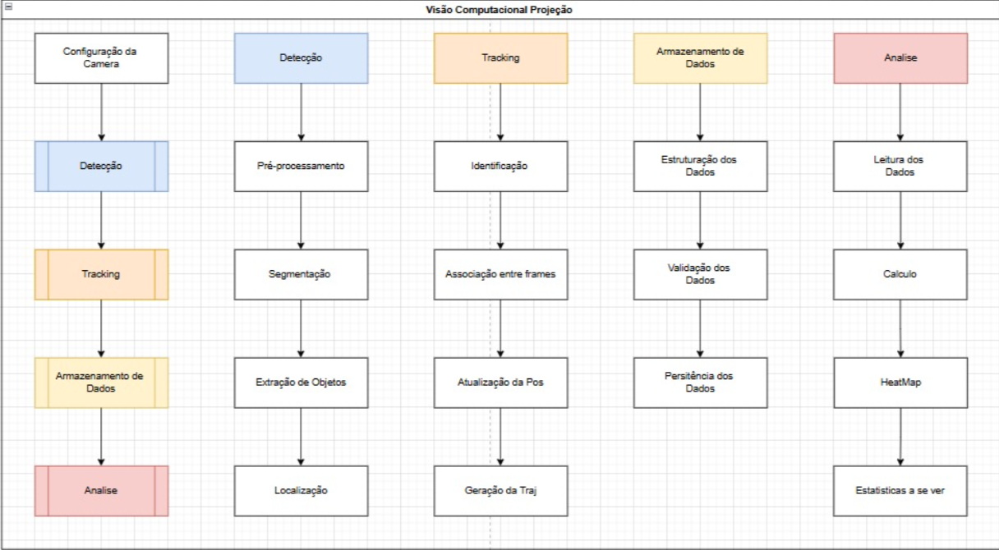

# CV worker pipeline

How `apps/cv-worker` turns a match recording into robot trajectories and heatmaps. The worker is built in small steps; each section says whether the stage is **done**, **in progress** or **planned**. Update this document when a stage changes what it takes or returns.

## Scope

- **Input:** one video file of one match, filmed from above the arena.
- **Output:** one trajectory file per match and one heatmap image per robot.
- **The worker only looks at the video.** It knows nothing about scores, referees or the match timer. It does not talk to the database or the API until the [persistence](#persistence) stage, which comes after the pipeline works on local videos.
- **The worker runs without a screen.** Windows and drawings are a debug option, never part of the pipeline (see [Debug view](#debug-view)).

## Robots and colors

Each robot carries a colored marker. The color is the robot's identity in the video, so the worker never has to guess which robot is which.

| Robot | Side in the API | Marker color |
| --- | --- | --- |
| Robot 1 | `A` (`robot_a_id`) | Blue |
| Robot 2 | `B` (`robot_b_id`) | Red |

The color ranges are calibrated against real footage and live in `config.py`. The arena, the lighting and the marker material all change them, so they are measured with the [HSV calibrator](#hsv-calibration) and never guessed.

## Pipeline



Each stage is one module in `src/`. A stage takes plain data (NumPy arrays, numbers, small dataclasses) and returns plain data, so it can be tested alone with a synthetic frame.

| # | Stage | Module | Takes | Returns | Status |
| --- | --- | --- | --- | --- | --- |
| 1 | [Capture](#1-capture) | `capture.py` | Video path | BGR frame, frame index, timestamp | Done (timestamp planned) |
| 2 | [Preprocessing](#2-preprocessing) | `preprocessing.py` | BGR frame | HSV frame | Done |
| 3 | [Segmentation](#3-segmentation) | `segmentation.py` | HSV frame, color ranges | Binary mask per robot | In progress |
| 4 | [Detection](#4-detection) | `detection.py` | Mask | Robot candidates | Planned |
| 5 | [Arena mapping](#5-arena-mapping) | `arena.py` | Pixel position | Arena position | Planned |
| 6 | [Tracking](#6-tracking) | `tracking.py` | Candidates per frame | Trajectory points | Planned |
| 7 | [Storage](#7-storage) | `storage.py` | Trajectory points | `trajectories.csv` | Planned |
| 8 | [Heatmap](#8-heatmap) | `heatmap.py` | `trajectories.csv` | One PNG per robot | Planned |

`main.py` only wires the stages together in this order.

### 1. Capture

Opens the video with `cv2.VideoCapture` and reads it frame by frame.

- Fails right away if the file cannot be opened.
- Each frame is a NumPy array of shape `(height, width, 3)` in **BGR** order (OpenCV's default).
- The timestamp of a frame is `frame_index / fps`, in seconds from the start of the video. `fps` comes from `CAP_PROP_FPS`.
- The capture is released when the video ends or the run is stopped.

### 2. Preprocessing

Prepares the frame for segmentation. It never detects anything.

1. **Noise reduction:** `cv2.GaussianBlur` with an odd kernel (`BLUR_KERNEL`). Smooths out sensor noise so single pixels don't flicker in and out of the masks.
2. **Color space:** `BGR → HSV` with `cv2.cvtColor`. In HSV the color (H) is separated from how strong (S) and how bright (V) it is, so one range covers a marker under brighter and darker lighting.

OpenCV's HSV uses `H` in `0–179` (degrees divided by 2) and `S`, `V` in `0–255`. Ranges taken from other tools (0–360, 0–100 %) must be converted.

### 3. Segmentation

Turns the HSV frame into one binary mask per robot: white where a pixel has the robot's color, black everywhere else.

1. **Color mask:** `cv2.inRange(frame_hsv, lower, upper)` for each range of the robot's color.
2. **Combine ranges:** a color may need more than one range. **Red always does**, because its hue wraps around: it sits at both ends of `H` (about `0–10` and `170–179`). The masks of all ranges are joined with `cv2.bitwise_or`.
3. **Arena mask (planned):** pixels outside the arena are set to black, so a red shirt in the audience never becomes a robot.
4. **Cleanup:** morphological **opening** (removes small white specks) followed by **closing** (fills small holes inside the marker), with an elliptical kernel of size `MORPH_KERNEL`.

Config shape for the color ranges:

```python
ROBOT_COLORS = {
    1: [((100, 120, 50), (130, 255, 255))],                                  # blue
    2: [((0, 120, 70), (10, 255, 255)), ((170, 120, 70), (179, 255, 255))],  # red
}
```

The values above are placeholders until the calibration is done.

### 4. Detection

Turns each clean mask into robot candidates.

1. `cv2.findContours` on the mask, outer contours only (`RETR_EXTERNAL`).
2. Drop contours smaller than `MIN_CONTOUR_AREA` pixels (leftover noise and reflections).
3. For each remaining contour, compute:
   - **centroid** `(x, y)` from `cv2.moments` (`m10/m00`, `m01/m00`);
   - **area**;
   - **bounding box** from `cv2.boundingRect` (for debugging).

A candidate is only a possible robot. Tracking decides which candidate, if any, is the robot.

### 5. Arena mapping

Planned. Converts a position in pixels into a position on the arena floor, so the heatmap does not depend on the camera angle or the video resolution.

- The four corners of the arena are marked once per camera setup and saved in the config.
- `cv2.getPerspectiveTransform` builds the transform from those corners to a square, and `cv2.perspectiveTransform` applies it to each centroid.
- The result is `x_arena`, `y_arena` in `0.0–1.0`, where `(0, 0)` is the top-left corner of the arena as seen in the video.
- The same four corners give the polygon for the arena mask in [segmentation](#3-segmentation).

Until this stage exists, `x_arena` and `y_arena` are left empty and the heatmap uses pixels.

### 6. Tracking

Keeps one position per robot per frame. The marker color already says which robot a candidate belongs to, so the first version stays simple:

1. Among the robot's candidates, take the one with the **largest area**.
2. If the robot was seen in a recent frame and the new candidate is farther than `MAX_JUMP_PX` from that position, reject it as a false detection.
3. If no candidate is left, the frame is a **miss** for that robot. A miss is recorded, not skipped and not filled in.

Smoothing, short-gap interpolation or a Kalman filter can be added later if the trajectories turn out to be noisy. They are not part of the first version.

### 7. Storage

Writes the trajectory of both robots to `data/output/<video name>/trajectories.csv`. This file is the contract between the pipeline and everything that reads its results (heatmap, statistics, and later the backend).

One row per robot per frame, misses included:

| Column | Type | Notes |
| --- | --- | --- |
| `frame` | integer | Frame index, starting at `0` |
| `timestamp_s` | float | Seconds from the start of the video, 3 decimals |
| `robot_id` | `1` \| `2` | See [Robots and colors](#robots-and-colors) |
| `detected` | `0` \| `1` | `0` for a miss; the position columns are then empty |
| `x_px`, `y_px` | integer | Centroid in pixels |
| `x_arena`, `y_arena` | float | Position on the arena, `0.0–1.0`; empty until [arena mapping](#5-arena-mapping) exists |
| `area` | integer | Contour area in pixels; helps spot bad detections |

```csv
frame,timestamp_s,robot_id,detected,x_px,y_px,x_arena,y_arena,area
120,4.000,1,1,620,380,0.412,0.287,1834
120,4.000,2,1,1104,512,0.733,0.395,1702
121,4.033,1,1,624,382,0.415,0.288,1810
121,4.033,2,0,,,,,
```

Before writing, each row is validated:

- `robot_id` is a configured robot;
- `frame` grows by one per frame and `timestamp_s` never goes back;
- a detected position is inside the frame (and inside `0.0–1.0` once arena mapping exists);
- a miss has every position column empty.

The **detection rate** of a robot is its number of `detected = 1` rows divided by its number of rows. It is the first number to check when changing calibration or cleanup, and it maps to `detectedPositions` in the web app's `RobotHeatmap` type.

### 8. Heatmap

Reads `trajectories.csv` and draws one image per robot in the same output folder.

1. Take the robot's detected positions (misses are ignored).
2. Count them in a 2D grid over the arena (`numpy.histogram2d`, `HEATMAP_BINS` cells per side).
3. Smooth the grid with a Gaussian blur so single cells don't look like noise.
4. Normalize to `0–255`, color it with `cv2.applyColorMap`, and optionally blend it over a frame of the empty arena.

Because each row is one frame, the color of a cell is proportional to **how long** the robot stayed there.

Statistics (distance traveled, average speed, time per arena region) are computed from the same file and come after the heatmap.

## HSV calibration

`tools/hsv_calibrator.py` opens a video and shows, side by side, the frame and the mask for the current range. Trackbars set the lower and upper `H`, `S`, `V`, and clicking a pixel prints its HSV value. The range is good when the marker is fully white through the whole video, including in corners and under shadows, and nothing else is.

Calibrate again whenever the camera, the lighting or the markers change.

## Debug view

With `--debug`, `main.py` opens windows with the original frame, the masks, the detected centroids and the last positions of each trajectory. `q` stops the run. All drawing lives in `debug.py`; the pipeline modules never call `cv2.imshow`, so the same code runs on a server with no display.

## Folder structure

```text
apps/cv-worker/
├── requirements.txt
├── data/
│   ├── videos/          # sample match videos
│   └── output/          # one folder per video: trajectories.csv and heatmaps (not committed)
├── tools/
│   └── hsv_calibrator.py
├── src/
│   ├── main.py
│   ├── config.py
│   ├── capture.py
│   ├── preprocessing.py
│   ├── segmentation.py
│   ├── detection.py
│   ├── arena.py
│   ├── tracking.py
│   ├── storage.py
│   ├── heatmap.py
│   └── debug.py
└── tests/               # pytest, using synthetic frames (for example a blue circle on a gray image)
```

## Persistence

Planned, after the pipeline works on local videos. The worker will hand `trajectories.csv` (or the same rows) and the heatmap images to the API for a given `matchId`; the API stores them and fills the match's `analysisStatus` and `heatmaps`. The upload format and the endpoint are not decided yet and will be added to this document when they are.

## Open questions

- **Video start vs. match start.** `timestamp_s` counts from the start of the video, which may begin before the match starts. Aligning it with `started_at` needs either a trimmed video or a known offset.
- **Pauses.** During a pause (`match_pauses`) the robots stand still, which would inflate their heatmap cells. Those frames should probably be dropped once the offset above is known.
- **Marker occlusion.** A robot that flips or hides its marker behind the opponent produces misses. The detection rate on real footage will tell whether this needs more than the first version of tracking.

## Development order

1. Capture and display frames. **Done**
2. Convert BGR → HSV, with noise reduction. **Done**
3. Calibrate the blue and red ranges with the HSV calibrator.
4. Generate and clean one mask per robot (red with two ranges).
5. Find contours and compute each robot's centroid.
6. Track one position or a miss per robot per frame.
7. Write and validate `trajectories.csv`.
8. Draw the heatmaps.
9. Mask out everything outside the arena and map positions to arena coordinates.
10. Add statistics.
11. Send the results to the API.
