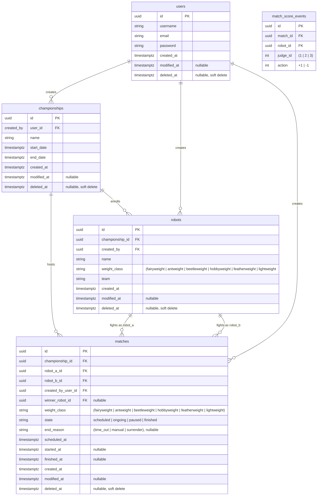

# Database model

This diagram shows the database we are working toward. It is not the current
schema. Some tables, columns, relationships and allowed values below don't exist
yet, or exist in a different form. Use it to guide new entities and migrations.

For the schema as it is today, read the migrations in
`apps/api/src/database/migrations/`. Those are the source of truth for what is
actually deployed.

