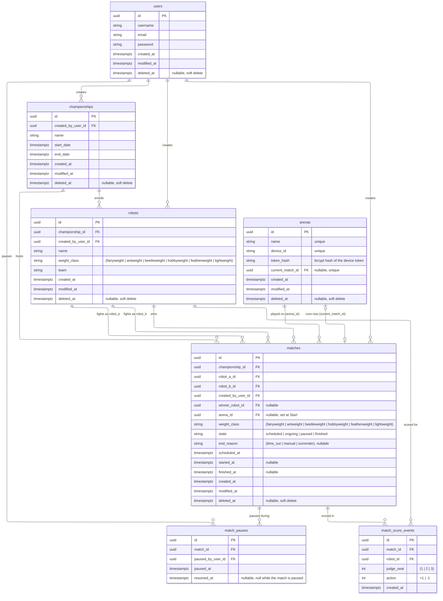

# Database model

This diagram shows the schema created by the baseline migration
(`InitialSchema`) and the `Arenas` migration. Allowed values in parentheses are enforced by CHECK
constraints. The migration also adds partial unique indexes that the diagram
doesn't show: case-insensitive `username` and `email` among live users,
case-insensitive robot `name` per championship among live robots, and at most
one open pause (`resumed_at IS NULL`) per match.

An arena is a physical box that runs one match at a time. `arenas.current_match_id`
is the live pointer to the match the arena runs now (or will run next); it is
unique, so a match is current on at most one arena, and it is cleared when that
match is deleted. `matches.arena_id` is the history of where a match was played,
written when the match starts. `arenas.name` and `arenas.device_id` are unique;
`token_hash` is the bcrypt hash of the device token (`npm run seed:arena`).

`championships.created_by_user_id` is the owning account. Robots and matches
belong to that account through their championship.

The migrations in `apps/api/src/database/migrations/` stay the source of truth
for what is deployed. Update this diagram when a new migration changes the
schema.

