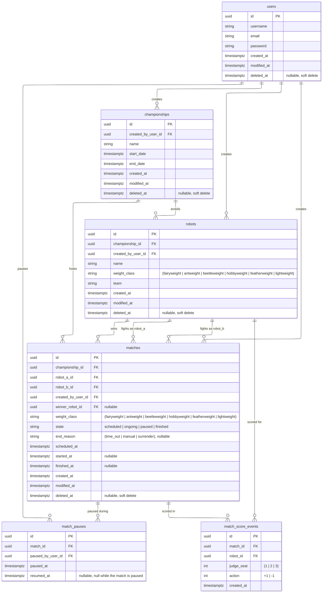

# Database model

This diagram shows the schema created by the baseline migration
(`InitialSchema`). Allowed values in parentheses are enforced by CHECK
constraints. The migration also adds partial unique indexes that the diagram
doesn't show: case-insensitive `username` and `email` among live users,
case-insensitive robot `name` per championship among live robots, and at most
one open pause (`resumed_at IS NULL`) per match.

The migrations in `apps/api/src/database/migrations/` stay the source of truth
for what is deployed. Update this diagram when a new migration changes the
schema.

